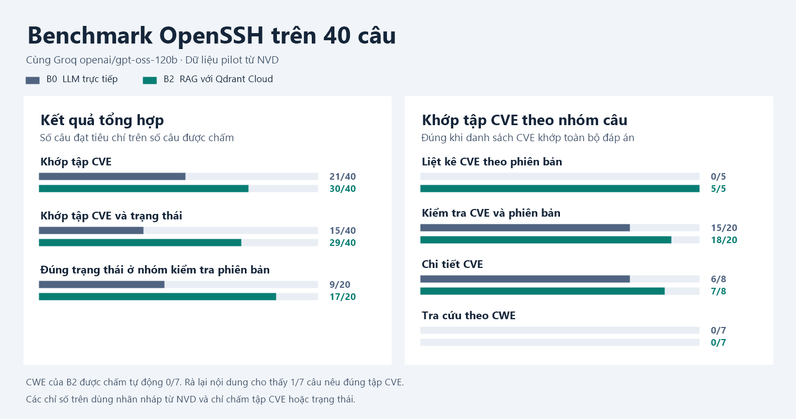

# Evaluation

The benchmark uses the same model and questions across the selected modes. With the default catalog, the builder generates draft questions and expected answers from the raw NVD snapshot.

## Build and review a dataset

After completing the NVD crawl, generate candidates.

```bash
python -m evaluation.build
```

| Question type | Draft answer |
| --- | --- |
| Version inventory | The CVE set returned for the requested version CPE |
| CVE/version check | `affected` for a matching CVE or `insufficient_evidence` for an adjacent-version case without a matching record |
| CVE detail | The CVE and source URL, plus the original description in `reference_answer` for reviewing the summary |
| CWE lookup | All CVEs in the product snapshot with the requested CWE. These questions exercise BM25 and Qdrant retrieval. |

Use `--product` to select a product and `--run` to pin its raw run. Use `--checks-per-version`, `--details-per-product`, and `--semantic-per-product` to cap candidate counts. The default output is `$ARTIFACTS_DIR/evaluation/questions.jsonl`. Use `--output` to choose another file.

Use `--from-processed` to build questions from the product scope and raw run IDs of the published processed snapshot. The `data_pipeline.prepare --evaluate` command uses this option before running the benchmark.

Check the expected CVEs, affected conditions, and citations against the original records. For natural-language descriptions, rewrite candidate CWE questions and verify the full set of matching CVEs. Select and freeze the reviewed dataset before benchmarking. See [questions.sample.jsonl](questions.sample.jsonl) for the JSONL format.

Generated rows have `review_status: draft`. Query membership means the CVE was returned for that exact NVD CPE query; it does not establish that every installation is affected regardless of platform or configuration. Absence from a query is not a `not_affected` label. For a negative label, record an explicit source-supported version or configuration conclusion.

### Review and freeze questions offline

Inspect coverage and export a review packet. These commands make no LLM or network requests.

```bash
python -m evaluation.review quality --dataset artifacts/evaluation/questions.jsonl
python -m evaluation.review packet --dataset artifacts/evaluation/questions.jsonl --output artifacts/evaluation/questions.review.json
```

The packet includes question text, source URLs, `reference_answer`, reference claims where available, label metadata, and counts by product, type, verdict and review status. Inspect the warnings for missing verdicts, conflicts and task imbalance. Review source conditions rather than accepting the generated labels automatically. Edit only each item's nested `review` object; the other fields are pinned to the source dataset.

An approved question review must include the following fields. Supply your actual review identity and timestamp, and a source excerpt supporting the label; the values below illustrate the shape only.

```json
{
  "review_status": "approved",
  "reviewed_by": "reviewer name",
  "reviewed_at": "2026-11-09T12:00:00Z",
  "label_basis": "Checked the version and required configuration in the source advisory",
  "label_evidence": [
    {"source_url": "https://example.org/advisory", "excerpt": "Source text supporting this label"}
  ],
  "reference_claims": ["The condition the answer must mention"]
}
```

The review may also correct `question`, `expected_cves`, `expected_status`, `expected_source_urls`, `reference_answer`, or `notes`. It cannot change the question ID, product or pinned raw run. Export a new dataset with only explicitly approved questions:

```bash
python -m evaluation.review freeze --dataset artifacts/evaluation/questions.jsonl --reviews artifacts/evaluation/questions.review.json --output artifacts/evaluation/questions.reviewed.jsonl
python -m evaluation.run --dataset artifacts/evaluation/questions.reviewed.jsonl --require-reviewed
```

`freeze` rejects missing approval provenance and refuses to overwrite files. Its `.review.json` sidecar records source/review/output hashes and omitted question IDs. Draft and rejected questions are omitted, so check the resulting distribution before benchmarking. `--require-reviewed` refuses a dataset containing any draft or rejected row. Review metadata is an audit trail supplied by the reviewer, not automatic verification that the evidence is true.

### Review saved answers and rescore

Use the run's saved dataset to pin the model outputs and processed corpus manifest as well:

```bash
python -m evaluation.review packet --dataset artifacts/evaluation/20261109T175123.151513Z/questions.jsonl --run-dir artifacts/evaluation/20261109T175123.151513Z --output artifacts/evaluation/pilot.review.json
```

For each answer, compare individual claims with `reference_answer`/source evidence. Rate `factual_correctness` against independently reviewed truth, `faithfulness` against the evidence actually supplied to the model, and `citation_support` against the claims attributed to each citation. If the exact supplied evidence is unavailable, leave faithfulness `null`; a URL or a CVE mention is insufficient to assign it. A nested answer `review` can look like:

```json
{
  "reviewed_by": "reviewer name",
  "reviewed_at": "2026-11-09T12:00:00Z",
  "notes": "Explain which statement is supported or contradicted and why",
  "evidence_sources": ["https://example.org/advisory"],
  "predicted_status": "affected",
  "asserted_cves": ["CVE-2024-1234"],
  "factual_correctness": true,
  "faithfulness": null,
  "citation_support": false
}
```

`predicted_status` and `asserted_cves` are optional parser corrections, not edits to the model answer. A correction cannot invent a CVE absent from the saved answer or turn a request failure into a successful response. Every answer review requires reviewer, timezone timestamp, explanatory notes and HTTP(S) evidence sources. Ratings must be booleans or `null`.

```bash
python -m evaluation.review rescore --run-dir artifacts/evaluation/20261109T175123.151513Z --reviews artifacts/evaluation/pilot.review.json --output-dir artifacts/evaluation/pilot.rescored
```

Omit `--reviews` to run only the updated scorer on saved outputs. Legacy text verdicts remain heuristic and are marked `legacy_inference`; original predictions are retained. Manual verdict corrections have an explicit audit trail. Approved question reviews may also correct gold labels offline: result rows preserve `original_label`, and a separate `reviewed_questions.jsonl` records the effective labels. Changing the question text requires a new generation run and is rejected during rescoring.

Rescoring pairs outputs by question ID, writes to a new directory, pins source hashes, and leaves the original run untouched. It makes zero generation calls and does not complete missing benchmark questions. Supply `--all-cve-ids` explicitly to evaluate CVE existence against a verified catalog; its hash is recorded. Missing catalog-dependent metrics stay `null`, even if the original run used a catalog. Original catalog metadata is retained separately as source provenance.

## Run the benchmark

Use `--modes` to run one or more modes. Each mode requires an LLM and a question file. The table lists the additional inputs and the matching result key in `summary.json`.

| Mode | Evidence | Additional inputs | Summary key |
| --- | --- | --- | --- |
| `llm_only` (B0) | The question alone | None | `baseline` |
| `llm_document` (B1) | Fixed processed evidence per product | Processed manifest and chunks | `document` |
| `llm_raw` (B1-Raw) | Fixed whole NVD JSON records per product | Raw run pinned by `raw_run_id` or by the processed manifest in a joint run | `raw` |
| `llm_bm25` | Top-k processed chunks ranked by BM25 | Processed manifest and chunks | `bm25` |
| `rag` (B2) | Structured version checks or hybrid retrieval | Processed manifest, records, chunks, and a Qdrant index for semantic questions | `rag` |

B1-Raw sorts unique CVEs by ID and uses the same records for every question about that product. The context preserves each included JSON record intact. BM25 resolves the product with the same parser as RAG, then ranks chunks by term matches in one pass. Both baselines use the shared evidence prompt and answer checks.

Set `LLM_PROVIDER` in `.env` or pass `--provider`. The default command runs B0 and B2. `--with-documents` selects B0, B1, and B2.

```bash
python -m evaluation.run
```

Use `--dataset` to run a reviewed file and `--limit` for a short smoke test. The runner matches each question's raw run against the processed manifest for the configured data source. Reports and per-question outputs are stored under `$ARTIFACTS_DIR/evaluation/<timestamp>/`.

For Groq, set `GROQ_API_KEY` and `GROQ_MODEL` in `.env`, then pass `--provider groq`.

After the [OpenSSH pipeline example](../data_pipeline/README.md#openssh-example), run a five-question smoke test from the generated file.

```bash
python -m evaluation.run --provider groq --limit 5
```

Add `--stream` to see raw LLM output as text deltas arrive, followed by the final validated answer and verdict:

```bash
python -m evaluation.run --provider groq --limit 5 --stream
```

Streaming supports Groq, Gemini, Ollama and OpenAI. The live draft can contain the model's JSON envelope; scoring, CVE/citation filtering and saved answers still use the fully assembled, validated response. Stream completion is required: a dropped connection or provider error is recorded as a failed attempt, even if partial text was displayed. Provider usage is read from streaming events, including Groq's `x_groq.usage` and OpenAI's final response. HTTP retries retain the existing policy. `run.json` records whether streaming was enabled.

Streaming protocol references: [Groq SSE and completion marker](https://console.groq.com/docs/api-reference), [Groq streaming usage fields](https://github.com/groq/groq-python/blob/main/src/groq/types/chat/chat_completion_chunk.py), [Ollama NDJSON](https://docs.ollama.com/api/streaming), and [OpenAI Responses events](https://developers.openai.com/api/reference/resources/responses/streaming-events).

Try the raw and BM25 baselines together with RAG, or pass a single mode such as `--modes llm_bm25` to run it independently. Comparisons with a context baseline use a shared 6,000-character evidence limit by default. Use `--context-max-chars` to change it for the run. Whole blocks that exceed the full budget are skipped. RAG applies the limit after retrieval, including for version inventories. `run.json` records the enabled modes, selection rules, raw run IDs, and context limit.

```bash
python -m evaluation.run --modes llm_raw llm_bm25 rag --limit 5
```

The runner saves `run.json`, the selected `questions.jsonl`, and the processed corpus manifest when used. It appends each answer to `<mode>_results.jsonl` as soon as the response is available. Each row includes the question, expected CVEs and status, model answer, verdict, assertions and any error. After a clean stop or interruption, `summary.json` reports the target questions, rows available for all modes, scored questions, and failures per mode.

The comparison scores questions for which all enabled modes completed without a request or retrieval error. Each pair of modes gets a score difference such as `rag_minus_bm25`. An incomplete run has `completed: false` and a nonzero exit code. Use the answer logs to inspect individual failures.

Groq calls are spaced by six seconds by default. Use `--request-interval` to set the minimum interval between LLM attempts and `--max-retries` to change the default of two retries for HTTP 429 and transient server errors. The runner honors a `Retry-After` delay up to one minute and stops on an exhausted rate limit or HTTP 401, 403, or 404. Reported per-question latency excludes deliberate pacing and retry waits. `wall_seconds` includes them.

## Inspect saved answers in the terminal

```bash
python -m evaluation.manual_check
# Or open a specific saved run:
python -m evaluation.manual_check artifacts/evaluation/20261109T175123.151513Z
```

Choose a run, then type a question number or ID. The viewer compares the system's saved reference answer with B0, B1 and B2 in terminal tables:

- A verdict table shows each mode's conclusion and whether it matches the reference.
- An **LLM efficiency** table shows input/output/total tokens, reasoning and cached tokens where reported, attempts, retries, failures, failure rate, total/mean LLM request time and observed output tokens/second for that question. Usage remains visible for failed or filtered answers. Pipeline latency is shown separately.
- A CVE matrix shows **one CVE per row**, with `System`, `B0`, `B1` and `B2` columns. `YES` means present and expected, `! MISSING` means an expected CVE was omitted, and `+ EXTRA` means a returned CVE is outside the reference set. `ERROR` and `NOT RUN` remain distinct from missing CVEs.
- A per-question evaluation table shows CVE exact match, verdict match, combined match, precision/recall/F1, evidence CVE recall, citation URL precision, expected URL hits and correct abstention where applicable. The task criteria explain what to inspect for that question type. Undefined per-question ratios display `N/A`.
- The question text, full reference text, model answers and source links appear immediately on selection. The full answers are shown side by side below the CVE matrix.

The viewer opens with an LLM efficiency overview for the whole saved run, including mean tokens per question, LLM latency p50/p95/p99 and mean/p95 TTFT for streaming runs. Type `u` to show it again. It uses all saved responses per mode, including unpaired and failed ones. `NOT RUN` means no saved response, `NOT RECORDED` means missing instrumentation or a provider count, and an explicit empty `llm_requests` list means zero calls and zero tokens. Partial token totals show the number of reporting calls, such as `120 (2/3 calls)`. Compare “Responses with logs” with “Saved responses” before interpreting totals from older runs. This viewer reads completed logs; live streaming is enabled on `evaluation.run` with `--stream`.

The reference is the saved dataset label, with its draft/review status shown; agreement is not independent verification of factual correctness. CVE assertions and per-question rule checks use the current scorer version printed in the viewer, without rewriting `summary.json`. New results use `asserted_cves` when present. Legacy results use the scorer's conclusion-aware assertion heuristic, which excludes identifiers merely repeated during a pure abstention and may differ from older saved scores.

There is **no LLM judge** in this evaluator. Factual correctness, faithfulness and citation support show only existing human ratings with valid review provenance; otherwise they display `NOT REVIEWED`. URL overlap is distinct from whether a source supports a claim. Faithfulness requires access to the evidence actually supplied to the model. The viewer reads saved files only, works offline and uses Python's standard library. It does not generate answers, write ratings or modify the run. Widen the terminal for longer answers, or use `--width 160` if your terminal supports it.

| Input | Action |
| --- | --- |
| `12` or a question ID | Open that question directly |
| `n` / `p` | Next / previous question; Enter also advances |
| `a` | Repeat the full reference/model answers and sources |
| `u` | Show the whole-run LLM efficiency metrics again |
| `r` | Pick another random question that has saved answers |
| `/CVE-2024-6387` or any search text | Search questions and saved answers |
| `/` | Clear the search |
| `l` / `l 2` | List matching questions / show the second list page |
| `q` | Exit |

Missing or failed responses are shown with the corresponding mode, so an interrupted run can still be inspected. For formal annotations and rescoring, use the separate `evaluation.review` commands above.

## Metrics

The main system evaluation has two metric groups, compared across the same benchmark modes:

| Group | Main measures | Report location |
| --- | --- | --- |
| Answer quality | CVE F1, CVE-and-verdict accuracy, citation URL matches, correct abstention and reviewed content quality | Per-mode quality summaries in `summary.json`; `answer_quality` rows in `metrics.csv` |
| LLM efficiency | Input/output/total tokens, mean tokens/question, mean and p50/p95/p99 request latency, streaming TTFT, observed output tokens/second, attempts, retries and failure rate | `summary.json` → `llm_usage`; `llm_efficiency` rows in `metrics.csv`; terminal check overview and question tables |

Every benchmark and offline rescore writes `metrics.csv` with `mode`, `metric_group`, `metric` and `value` columns. Missing values are blank. Efficiency includes every saved response, while quality comparisons use successful questions paired across all selected modes. Inspect saved question counts and log coverage when a run is incomplete. Offline rescoring derives efficiency from the original request logs and makes no new LLM calls. Existing saved runs can be inspected directly in the updated terminal viewer without regeneration.

New generations request JSON with separate `verdict`, `answer` and `asserted_cves` fields. Verdict scoring reads that field rather than finding negative words anywhere in the explanation. `asserted_cves` identifies CVEs asserted as answer content, separately from identifiers merely mentioned while abstaining. The response and its assertions still need factual review. Legacy outputs use a flagged text heuristic for compatibility; new malformed structured outputs are recorded as output errors rather than guessed into a valid verdict.

`scorer_version` identifies the metric implementation. `citation_url_precision` and `citation_url_coverage` measure expected URL matches only; older `citation_precision`/`citation_coverage` keys are compatibility aliases. These do not measure whether the page supports a claim. Manual factual correctness, faithfulness and citation support are reported separately with their own reviewed denominators and stay `null` without valid reviews. Metrics for absent verdict/conflict groups include denominators and return `null` instead of implying a failed test of that group. Inspect per-type/product slices and macro scores alongside CVE micro F1, which weights questions with many expected CVEs more heavily.

`summary.json` reports `llm_usage` per mode for all attempted questions. It includes input, output, and total tokens, plus reasoning and cached input tokens when the provider reports them. Output counts include reasoning where the provider includes it or reports it separately. `reported_attempts` gives the denominator for each token total. A missing provider count is `null` when no attempt reports that field. Modes that made zero calls used zero tokens.

Each answer row includes `llm_requests` with token counts, duration, and success for each generation attempt. The summary counts retries and calls whose responses were filtered after generation. `average_request_latency_seconds` measures the generation request, including network time and excluding retrieval and pacing. `questions_with_llm_call` shows how often each mode called the model.

`average_total_tokens_per_question` divides total tokens by all saved responses, including zero-call responses, only when every response has request logs and every attempt reports total tokens. Otherwise it is `null`. `retry_attempts` counts extra attempts after the first for each question; the runner makes one logical generation call per question. `failed_request_rate` uses attempts with a recorded success flag. Request latency percentiles use recorded attempt durations with linear interpolation. Pipeline latency has its own reported-question count and includes retrieval; it excludes deliberate pacing/retry waits.

`output_tokens_per_second` is the sum of reported output tokens divided by the sum of their matching successful request durations; `throughput_reported_attempts` records its sample count. It includes network and request overhead, and output tokens may include reasoning. It is not a measurement of decoding speed alone. Failure, token and latency reporting counts are exported alongside their metrics. Monetary cost is not measured by this evaluator.

With `--stream`, each request records `ttft_seconds`: elapsed time from request start to its first nonempty output text delta. This includes network time and excludes retrieval and deliberate pacing. Metadata, role-only chunks and reasoning-only events do not trigger TTFT; a JSON envelope's first text does. `average_ttft_seconds` and `p95_ttft_seconds` summarize measured attempts, with `ttft_reported_attempts` as their denominator. Failed attempts that emitted text retain their TTFT. Nonstreaming/older logs leave these metrics `null` and show `NOT RECORDED`; zero-call responses show `N/A`.

`evidence_cve_recall` measures the fraction of expected CVE mentions present in the selected evidence. Compare it with answer `cve_recall` to see whether a missing CVE was available to the model. It is `null` for B0 and for slices without expected CVEs.

The report includes exact CVE-set match, status accuracy, combined CVE-and-status accuracy, version status accuracy, CVE precision, recall and F1, citation URL precision and coverage, correct abstention, and latency. Version status accuracy uses the CVE/version checks as its denominator. The CVE-outside-catalog metric uses an optional global NVD snapshot. Refresh it with the following command.

```bash
python -m data_pipeline.cve_catalog --refresh
```

Metrics that require the global snapshot are `null` when it is unavailable. The report includes catalog metadata when its manifest matches the CVE list used in the run. A partial or older catalog can overcount missing IDs. Use a verified complete snapshot for claims about CVE existence.

## OpenSSH pilot results

The pilot ran B0 and B2 on the same 40 draft NVD questions with Groq `openai/gpt-oss-120b`. The chart counts questions that met each criterion.



| Metric | What it counts | B0 | B2 |
| --- | --- | ---: | ---: |
| Exact CVE set | Questions where the predicted and expected CVE sets are equal | 21/40 | 30/40 |
| Exact CVE set and status | Questions where both the CVE set and the verdict match | 15/40 | 29/40 |
| Version status accuracy | Correct verdicts within the 20 CVE/version checks | 9/20 | 17/20 |
| CVE micro F1 | Harmonic mean of precision and recall, counting each CVE once per question and pooling across questions | 20.3% | 96.8% |

Five inventory questions account for 157 of the 192 expected CVE mentions, so they carry most of the weight in micro F1. The pilot scorer inferred verdicts from text and checked citation URLs against expected URLs. Verifying whether a citation supports the explanation, severity, or remediation requires reviewing the claim and its evidence. The pilot used draft labels and covered B0 and B2; its original scores have not been overwritten by the updated scorer.

### Scored examples

| Question from the pilot | Draft answer | What happened |
| --- | --- | --- |
| Is OpenSSH `9.5p1` affected by `CVE-2023-51384`? | `affected` and the named CVE | Both modes named the CVE. B0 said `not_affected`, so it passed the CVE-set check and failed the verdict check. B2 matched both. |
| Which OpenSSH CVEs in the snapshot belong to `CWE-1284`? | `CVE-2026-59997` | B2's top five missed the expected CVE and the answer abstained. The scorer marked the CVE set wrong. |
| Which OpenSSH CVEs in the snapshot belong to `CWE-284`? | `CVE-2023-51384` | B2 named the expected CVE. The verdict parser interpreted uncertainty about the other candidates as an abstention and marked the answer wrong. A manual check of CWE membership counted this case as correct. |
